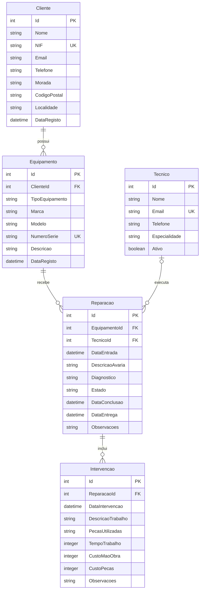

# Diagrama Entidade-Relação

## Cardinalidades e notas

- Um cliente pode ter zero ou vários equipamentos; cada equipamento tem exatamente um cliente.
- Um equipamento pode ter zero ou várias reparações; cada reparação tem exatamente um equipamento.
- Um técnico pode estar associado a zero ou várias reparações; uma reparação pode não ter técnico ou ter um técnico.
- Uma reparação pode ter zero ou várias intervenções; cada intervenção pertence a exatamente uma reparação.
- Os valores inteiros de duração e custo são centésimas da unidade indicada no modelo.
- As relações têm eliminação restrita para proteger os registos históricos.
